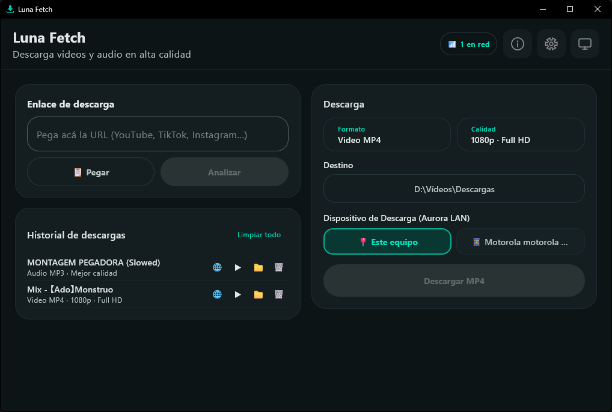
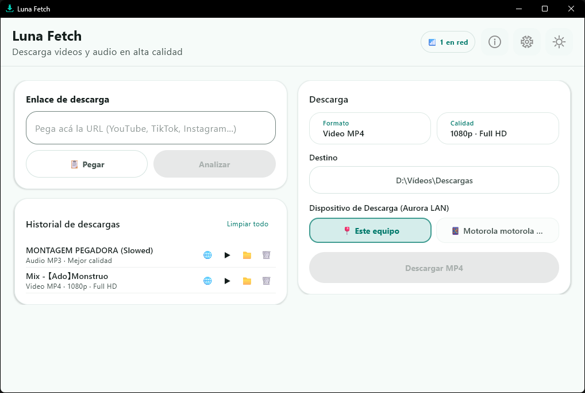

# Luna Fetch 🌙 — v1.2.1

[](https://github.com/biglexj/Luna---Fetch/releases/tag/v1.2.1)
[](LICENSE)
[](#plataformas)

Luna Fetch es una aplicación multiplataforma para analizar y descargar videos o audio mediante `yt-dlp` y FFmpeg. Está construida con Kotlin Multiplatform y Compose Multiplatform para compartir interfaz, estados y reglas entre Windows, Linux y Android.

## 📸 Capturas de Pantalla

| Modo oscuro | Modo claro |
| :---: | :---: |
|  |  |

## Organización de recursos

El icono canónico de identidad se conserva en [`assets/branding/icons/icon-transparent.png`](assets/branding/icons/icon-transparent.png). Los recursos derivados deben generarse desde esa fuente conforme al [Asset Organization Standard](../Core-Docs/global/architecture/asset-organization-standard.md); las capturas documentales viven en `docs/screenshots/`.

## Funciones

- Análisis de enlaces con título, autor, duración y miniatura.
- Video MP4/WebM hasta la resolución disponible.
- Audio MP3, M4A, FLAC y WAV con perfiles de calidad.
- Metadatos y portada embebida en audio cuando la fuente los proporciona.
- Descarga completa de playlists y álbumes con numeración de pistas.
- Extractor nativo de Suno AI: descarga la canción con portada y letra sincronizada (`.lyrics.txt`) y distingue las canciones instrumentales.
- Extensión de navegador con importador de listas de Suno: publica en lote las canciones de la lista abierta, captura el enlace público de cada una y las envía a Luna Fetch en un solo envío.
- Carpetas por tipo de medio: cada descarga se ordena en `Música` o `Videos` dentro de la carpeta de destino, con los mismos nombres en el escritorio y en Android.
- Cola de descargas secuencial con deduplicación de enlaces y verificación de archivos ya descargados.
- Progreso, velocidad, tamaño, ETA, posprocesamiento y registro técnico.
- Cancelación de descargas y apertura del resultado.
- Notificaciones del sistema operativo con el estado de cada descarga.
- Preferencia persistente de carpeta de destino.
- Tema automático, claro y oscuro con Material 3.
- Color dinámico del sistema en Android 12 o posterior.
- Servicio en primer plano para descargas Android.

## Plataformas

- **Windows:** aplicación JVM de escritorio distribuida como instalador **EXE** (Inno Setup, plantilla Biglex Modern 2.0) desde GitHub Releases y, cuando sea aceptada, mediante Winget. La línea anterior de MSI queda documentada en [`packaging/windows/MIGRATION.md`](packaging/windows/MIGRATION.md).
- **Linux:** aplicación JVM y configuración para paquetes DEB/RPM.
- **Android:** interfaz compartida, almacenamiento mediante selector del sistema y motor local con Python, `yt-dlp` y FFmpeg.

En escritorio, `yt-dlp` y FFmpeg deben estar disponibles en `PATH`. En Android el motor se incluye dentro de la aplicación, busca una actualización estable cada 24 horas y puede obtener los componentes EJS oficiales necesarios para YouTube.

## Extensión de navegador

La extensión de Chromium (Chrome, Edge, Brave y Opera) vive en [`browser-extension/`](browser-extension/) y va en su propia línea de versiones: la **v1.4.4** acompaña a la 1.2.1 de la aplicación. No se instala con el instalador de Windows; se carga de forma manual:

1. Abre `chrome://extensions` (o `edge://extensions`).
2. Activa **Modo de desarrollador**.
3. Pulsa **Cargar descomprimida** y elige la carpeta `browser-extension` del repositorio.

Desde el popup se envía cualquier enlace al escritorio. En las páginas de Suno, el botón **☀️ Luna Fetch** abre el importador de listas, que publica las canciones de la lista abierta y envía sus enlaces públicos en un solo envío.

## Desarrollo

Requiere un JDK completo 17 o posterior. Para Android, configura `ANDROID_HOME`.

```powershell
$env:ANDROID_HOME = Join-Path $env:LOCALAPPDATA "Android\Sdk"
.\gradlew.bat :composeApp:desktopTest :composeApp:compileDebugKotlinAndroid
```

Ejecutar escritorio:

```powershell
.\gradlew.bat :composeApp:run
```

Generar APK de depuración:

```powershell
.\gradlew.bat :composeApp:assembleDebug
```

Banco de pruebas del importador de listas de Suno (extensión de navegador): el
script levanta una réplica local de la interfaz de Suno, abre un Chromium sin
cabeza e inyecta los ficheros reales de la extensión para comprobar la
publicación en lote, la captura de enlaces, el envío por lotes, el
autoenvío, el modo API y su degradación.

```powershell
node test\suno-import\run-test.mjs
```

## Operación con Mise (Estándar Ecosistema)

Luna Fetch implementa la interfaz universal de tareas mediante Mise:

| Tarea | Propósito |
|---|---|
| `mise dev` | Ejecutar en modo desarrollo (`:composeApp:run`). |
| `mise build` | Compilar ejecutable de escritorio (`:composeApp:packageExe`) sin generar instaladores. |
| `mise release` | Generar distribuibles locales en `release/` (Setup `.exe`, APK y `SHA256SUMS.txt`) sin publicar. |
| `mise publish` | Publicar en GitHub Releases y sincronizar ficha en Aurora (`--plan` y `--check` sin escritura). |

Opciones de inspección y comprobación:
- `--plan`: Muestra el comando y las operaciones planificadas sin ejecutar procesos ni modificar el sistema (`mise dev --plan`, `mise release --plan`, `mise publish --plan`).
- `--check`: (para `publish`) Verifica el estado del repositorio, tags, notas y la presencia e integridad de los artefactos en `release/` sin publicar nada (`mise publish --check`).
- Canal explícito `github`: `mise publish github` (omite la sincronización con la web de Aurora).

## Distribución

### Windows y Android
```powershell
.\scripts\build\build-release.ps1 -LocalOnly -SkipSigning
```

### Linux (Arch Linux, AppImage, DEB)
```bash
./scripts/build/build-linux.sh
```

El build local de Windows deja en `release/` el instalador `LunaFetch-Windows-<versión>.exe`, el APK de depuración de Android y `SHA256SUMS.txt` con los checksums de los artefactos publicados. En Linux genera paquetes `.pkg.tar.zst` (Arch), `.AppImage` y `.deb`. Una publicación oficial requiere el certificado de Windows y la firma Android descrita en [docs/packaging.md](docs/packaging.md); publica el instalador EXE y los APK por arquitectura (ARM64, ARM32 y x86_64). MSIX y Microsoft Store están fuera de la distribución del proyecto.

## Licencias

El código propio de Luna Fetch se publica bajo MIT. La distribución Android incorpora componentes con licencias adicionales, incluido `youtubedl-android` bajo GPL-3.0. Consulta [THIRD_PARTY_NOTICES.md](THIRD_PARTY_NOTICES.md) antes de redistribuir un APK.

Biglex J · 2026
